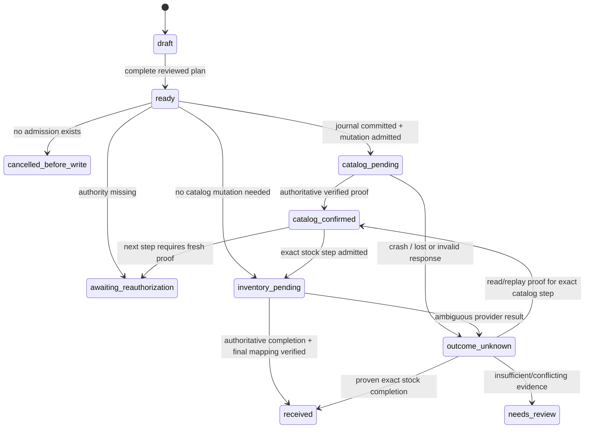

# Hosted receiving: schema 6 and typed saga proposal

Development design, 2026-10-29. This document proposes the next implementation;
it does not apply a migration, enable a worker, grant OAuth permissions or prove
provider/device acceptance. Phase 1 physical claims and schema 5 stay frozen while
the desktop claim flow and full regression evidence are completed.

## Approved scope and implementation order

Implement a server-owned receiving operation that shares the central physical
claim with the accepted trade. Square credentials remain encrypted on the server.
New claimed or hosted-accepted desktop receipts must never fall back to the local
Square vault or the old receiving journal.

1. Persist typed plans, revisions, trusted catalog bindings and an exact provider
   journal; implement the complete same-price existing-variation inventory path
   with an injected fictional provider and PostgreSQL crash/concurrency tests.
2. Add the new-price sibling path with complete existing-parent preservation,
   version conflicts and collision/unknown-outcome coverage. This remains part of
   the commercial objective; review-only behavior in the first path is temporary.
3. Add new-parent creation only after an owner approves a server catalog/tax
   template. Template approval, receiving enablement and new-parent enablement
   are separate explicit states, all initially false/unapproved.
4. Validate actual OAuth re-consent, controlled provider acceptance, real store
   locations, label/scanner behavior and operational recovery before activation.

At most 100 resolved inventory targets, one catalog batch and one inventory
change request are supported in this version. Original manifests may contain more
rows, but every selected/excluded quantity must be explicit. Never silently split
an original delivery into a fresh claim or make an automatic continuation.

## Physical workflow and authority

The following decisions are already approved:

- A consumed trade claim permits one inventory operation only for its exact
  `bound_trade_id`, accepted receipt hash and immutable accepted line quantities.
  Original rows excluded from the trade are not eligible receiving stock.
- An inventory-only operation can use an OPEN claim. Once ANY provider step is
  admitted, the same claim can never issue a new hosted cash agreement or credit.
  An admission that times out still blocks financial conversion. Receiving stock
  does not invent a purchase, customer, payment, credit or approved tax origin.
- Before any provider step is admitted, an enabled owner/manager can explicitly
  revise the SAME operation/revision, including its selected rows or workflow.
  Preserve every prior plan hash. After admission, changing merchant, location,
  source, targets, quantities, prices or exact provider bodies is forbidden.
- An owner/manager with enrolled MFA proof no older than 15 minutes must authorize
  EACH newly admitted Square mutation. Recheck database session, current role,
  enabled staff, MFA version and proof age. Read-only outcome recovery needs a
  current authorized owner/manager, without silently admitting another write.
- Disabling staff, signing out or losing permissions stops later admissions.
  An already admitted external call can finish; its outcome must still be saved.
  PostgreSQL and an external provider cannot be made one atomic transaction.
- An uncertain operation keeps its physical-operation slot and seller lane.
  Lease expiry, UI cancellation, file deletion, another PC or another request key
  cannot release or replace it.

Financial acceptance and inventory-only admission both lock the central claim
row. Extend the schema 5 final-trade DB guard to reject a new acceptance when an
inventory-only admission already exists. This also protects against an older
application process that does not know the new workflow check. Existing accepted
receipts remain immutable and recoverable. No existing stock or balance is
backfilled or inferred during migration.

## Existing Square authority helper

`Square.verified_access(tenant, required_scopes)` already returns an ephemeral
`VerifiedSquareAccess(token, proof)` whose token is excluded from `repr`. It
introspects the actual production token and verifies configured app, saved
merchant, environment, expiry and actual grants; it rechecks the saved connection
after the read. `verified_grants` returns the token-free proof projection.

The receiving adapter must use the SAME ephemeral token for the admitted call,
not fetch a different unverified token afterward. Save only minimal proof facts
and their hash; never serialize the token or Authorization header. The helper is
not staff authorization and does not freeze a receiving plan by itself.

Current OAuth authorization requests remain read-only. Receiving needs explicit
owner re-consent for `ITEMS_WRITE` and `INVENTORY_WRITE`, alongside the required
read/profile permissions. Record an OAuth capability-profile version in the
authorization state and resulting connection proof. A reconnect must match the
same store/merchant/environment; it cannot reassign an uncertain operation.
The saved status screen's requested scopes are not granted-scope evidence.

Sandbox token proof currently fails closed without provider calls because the
official introspection credential context is production. A documented, tested
Sandbox strategy remains a prerequisite to realistic provider acceptance; do not
substitute requested scopes or a successful unrelated read as write authority.

## Proposed schema 6

Names/constraints below are the implementation contract to review, not executed
DDL. Use tenant-qualified foreign keys everywhere; provider IDs are opaque,
bounded strings validated separately from application UUIDs and URL-quoted only
inside a fixed server adapter.

| Table | Required stored facts and constraints |
| --- | --- |
| `ss_receiving_settings` | Tenant PK; `receiving_enabled=false`, `new_price_enabled=false`, `new_parent_enabled=false`; policy version and approved template reference; no automatic enablement from migration or OAuth. |
| `ss_catalog_binding_versions` | Tenant, binding UUID/version PK; merchant/environment/app; full reviewed identity JSON and identity hash; parent/variation IDs; retained base and target SKUs; optional approved family/variation-template reference; location and effective USD price/tracking proof; exact snapshot hashes; approval actor/time/reference. New rows default unapproved. Approved evidence immutable; revocations are append-only records. |
| `ss_catalog_binding_revocations` | Tenant/binding/version FK, current authorized actor/time/reason. Stops new admissions; never erases the binding used by an uncertain operation. |
| `ss_catalog_templates` | Immutable tenant/template/version; explicit regular-goods, whole-unit, tax IDs/taxability, location availability, sellable/stockable/tracking and new-variation policies. Defaults unapproved; owner-reviewed provenance. New-parent approval does not establish Idaho trade-credit tax eligibility. |
| `ss_receiving_operations` | Tenant/operation UUID PK; permanent UNIQUE tenant/claim ID; server-bound merchant/environment/app/location; workflow kind `accepted_trade` or `inventory_only`; optional exact accepted trade/hash; current revision/state; created/updated actors; first admission time; terminal receipt hash. Identity cannot change after first admission. |
| `ss_receiving_plan_revisions` | Tenant/operation/revision PK; immutable normalized domain input, original manifest hash, reviewed source snapshot hash, selected/excluded quantity maps, trusted binding versions, provider read snapshot hashes, template/policy versions, typed target projection and plan hash. Prior revisions retained. |
| `ss_receiving_requests` | Tenant/request key PK; action enum, immutable intent hash, operation/revision and compact result. Distinguish plan, revise, commit, authorize, recover and cancel requests. One key cannot change its action/body. |
| `ss_receiving_seller_lanes` | UNIQUE environment/merchant seller lane; tenant, occupied operation, state and version. Temporary execution lease/token/expiry is separate from durable occupancy. Unknown outcomes retain occupancy after lease expiration. |
| `ss_receiving_steps` | Tenant/operation/ordinal PK; endpoint enum `catalog_batch` or `inventory_batch`; pinned API version; immutable canonical body SHA256 and authenticated encrypted body; one persisted UUID provider idempotency key; request/reference IDs; frozen occurrence timestamp; state; first dispatch time, authorization proof hash, attempt count, next retry time, lease/fencing generation. No headers or tokens. |
| `ss_receiving_step_attempts` | Immutable attempt ID, exact step/body/key binding, admission time and authorized staff/session-hash/MFA-version facts, verified-grant proof hash, HTTP/result-classification evidence, minimal outcome hash, provider adjustment/object IDs where proven. No plaintext credentials or uncontrolled raw error text. |
| `ss_receiving_exceptions` | Tenant/operation/step/code, first/last seen, occurrences, minimal bounded evidence and resolution actor/time/reference. Review resolution records evidence; it does not fabricate provider success or rotate a key. |
| `ss_receiving_receipts` | One immutable terminal receipt per operation: plan/source/provider identities, selected/excluded maps, verified authoritative SKU/variation/location/quantity mappings, provider evidence IDs/hashes, catalog/inventory completion facts and receipt hash. Local labels consume only this validated result. |

Immutable body encryption must bind tenant, operation, step, endpoint and API
version in the authenticated envelope. Decryption into another row must fail.
Store canonical request bytes and send those exact bytes, with fixed JSON
headers, on every eligible retry. JSON reserialization, a new occurrence time or
a newly generated idempotency key must not alter an admitted step.

Add guards for final operations/receipts, immutable revisions/steps, provider-key
uniqueness per seller, one operation per physical claim and monotonic admission.
A prewrite cancellation does not delete the operation slot. Explicit reopening
uses the same operation ID and a new reviewed revision, with no prior admissions.

## Trusted catalog-mapping onboarding

The same-price path needs a way to establish trustworthy mappings; the existing
desktop catalog is not automatically trusted merely because it has a matching
SKU or legacy metadata. No automatic SKU adoption or bulk conversion is proposed.

Proposed owner-only, fresh-MFA mapping approval flow:

1. Read candidate variation and complete related parent using hosted OAuth read
   authority. Search results, object IDs and versions come from the provider,
   not a raw URL or payload supplied by the desktop. Return a compact review view.
2. The owner selects full card/game/slab/sports identity from reviewed source
   facts and explicitly maps that identity to the candidate variation and parent.
   Show retained SKU, effective location price, currency, tracking, measurement,
   availability, options and existing siblings. Identify unmanaged metadata as
   unproven rather than presenting a guessed match as approved.
3. Re-read current objects on approval. A changed snapshot/version requires new
   review. Persist an immutable approved binding version with actor/provenance.
   This is an owner-reviewed identity assertion; it does not authenticate a
   manufacturer certificate or approve a tax policy.
4. A same-price inventory plan can use the approved binding only while current
   catalog identity anchors, parent/variation relation, SKU, price, currency,
   whole-unit tracking and selected-location availability still match. Revoked,
   changed, duplicate or ambiguous mappings stop before writes.

Proposed routes: `POST /api/catalog-bindings/previews` with a typed variation ID
and reviewed identity; `POST /api/catalog-bindings/<preview_id>/approve` with
snapshot hash, explicit identity confirmation and reason; and a versioned revoke
route. These are proposed, not existing endpoints. Owner approval writes only the
application registry; it must not silently edit the seller's Square catalog.

A Square `user_data` marker can be a secondary anchor but is not authority by
itself: sellers/other integrations may edit catalog fields. Keep metadata within
the documented 255 code-point limit and preserve any existing metadata. Match
the server's tenant/provider-bound registry and current authoritative catalog.

## Proposed typed receiving API

Unknown keys are rejected. Tenant, merchant, environment, app, provider URLs,
headers, catalog object IDs, provider keys and final Square payloads are
server-owned. Browser/desktop callers never submit an arbitrary Square request.

`POST /api/receiving/plans`:

```json
{
  "request_key": "persisted-before-first-network-call",
  "physical_intake_id": "central-claim-uuid",
  "physical_manifest_hash": "64-hex",
  "source_snapshot_hash": "64-hex-of-locked-local-review",
  "workflow_kind": "accepted_trade",
  "accepted_trade_id": "hosted-trade-uuid",
  "accepted_receipt_hash": "64-hex",
  "location_id": "opaque-Square-location-ID",
  "new_inventory_confirmed": true,
  "excluded_not_received_ack": true,
  "lines": [
    {
      "review_line_id": "stable-review-row-uuid",
      "source_line_key": "64-hex-original-source-key",
      "accepted_line_id": "hosted-line-uuid",
      "quantity": 2,
      "selling_cents": 1250,
      "zero_price_confirmed": false
    }
  ]
}
```

For an accepted trade, derive identity, original source binding, maximum quantity,
customer and intake cost from the immutable server receipt. Caller fields cannot
replace them. The line DTO supplies retail price and selection, not purchase
amounts. Inventory-only requests instead supply reviewed identity bound to each
original source key, with an explicit external-delivery ownership attestation;
this is not a customer credit/purchase document. Do not mix modes in one request.

Price-split reviewed lines need distinct stable review-line IDs in addition to a
source key. Aggregate their quantities against the original/accepted budget so
two selling prices cannot duplicate physical units. Unpriced, unreviewed,
fractional/boolean/negative/overflow values fail the entire plan explicitly.

The result includes:

```json
{
  "receiving_id": "operation-uuid",
  "revision": 0,
  "state": "ready",
  "plan_hash": "64-hex",
  "physical_intake_id": "central-claim-uuid",
  "physical_manifest_hash": "64-hex",
  "source_snapshot_hash": "64-hex",
  "workflow_kind": "accepted_trade",
  "accepted_trade_id": "hosted-trade-uuid",
  "accepted_receipt_hash": "64-hex",
  "provider": {"merchant_id": "opaque", "environment": "production", "application_id": "opaque", "location_id": "opaque"},
  "targets": [{"review_line_id": "uuid", "source_line_key": "64-hex", "identity_hash": "64-hex", "binding_id": "uuid", "binding_version": 1, "binding_evidence_hash": "64-hex", "source_sku": "retained", "target_sku": "authoritative", "variation_id": "opaque-or-null-before-catalog", "selling_cents": 1250, "currency": "USD", "quantity": 2, "action": "reuse_existing"}],
  "selected_quantities": {"source-key": 2},
  "excluded_quantities": {"source-key": 0},
  "catalog_writes_required": false,
  "inventory_confirmed": false,
  "requires_fresh_mfa": true,
  "blocked_reasons": []
}
```

The client verifies the complete frozen projection before allowing commit. A
temporary `#` catalog ID is never a confirmed variation or printable final label.
`ready` is a reviewed plan state, not inventory success or permanent OAuth proof.

| Proposed route | Body and behavior |
| --- | --- |
| `GET /api/receiving/requests/<request_key>` | Recover the original compact result after a lost plan/commit response. No new operation or mutation. |
| `GET /api/receiving/<id>` | Current typed status, exact plan/claim/provider binding, minimal exceptions and immutable terminal receipt if present. Never raw journals/tokens. |
| `PUT /api/receiving/<id>/plan` | Stable new request key, current revision, full normalized domain revision and explicit replacement confirmation; only before ANY provider admission. Preserves old revision/hash. |
| `POST /api/receiving/<id>/commit` | `{request_key,revision,plan_hash,confirmed:true,excluded_not_received_ack:true}`. Durable commit, authority checks and seller-lane acquisition; no body/key regeneration. |
| `POST /api/receiving/<id>/recover` | Stable request key and expected plan hash; current owner/manager read-only outcome reconciliation. It cannot authorize an external mutation. |
| `POST /api/receiving/<id>/authorize` | `{request_key,revision,plan_hash,resume_same_operation:true}` after fresh MFA. Re-authorizes exact saved targets/body/keys; does not change principal/provider/source. |
| `POST /api/receiving/<id>/cancel` | Version/hash/reason; only before ANY admission. Later requests return an actionable uncertainty/partial-completion state and retain occupancy. |

Typed errors should distinguish `RECEIVING_DISABLED`, `CLAIM_WORKFLOW_CONFLICT`,
`ORIGINAL_SOURCE_REQUIRED`, `UPGRADE_REIMPORT_REQUIRED`, `MFA_STEP_UP_REQUIRED`,
`OAUTH_RECONSENT_REQUIRED`, `SANDBOX_AUTHORITY_UNVERIFIED`,
`CATALOG_MAPPING_REVIEW_REQUIRED`, `CATALOG_VERSION_CHANGED`,
`SKU_COLLISION_REVIEW_REQUIRED`, `PLAN_CHANGED`, `SELLER_OPERATION_PENDING` and
`PROVIDER_OUTCOME_UNKNOWN`. Include only safe same-tenant operation/claim IDs and
structured retry/review facts, not upstream body text or credentials.

## Catalog paths that preserve existing stock

### Existing trusted variation at the exact effective price

Retrieve current provider objects and validate binding/version anchors. Apply
selected-location overrides for both price and tracking; an explicit false
tracking override cannot be treated as an absent value. Require fixed USD price,
whole-unit stock, selected-location availability and no unresolved conversion or
option semantics. Reuse the existing variation ID and SKU exactly. Do not send a
catalog update, change price, change old stock or turn on tracking as a side effect.

### New price for a trusted existing identity

This planned expansion creates or reuses a NEW price variation, preserving old
ones. It must not use the old variation as a repricing shortcut.

1. Resolve an approved family/base-SKU anchor. Search all relevant candidate SKUs
   with pagination; a SKU is not guaranteed unique merely because our database
   registry is unique. Reuse a trusted matching-price sibling only after exact
   identity/parent/location validation. Unmanaged or conflicting candidates stop.
2. If creation is needed, snapshot the complete current parent and ALL nested
   variations. Deep-copy its writable facts, sibling IDs/order/data, categories,
   tax settings, options, custom attributes, availability and existing metadata.
   Append only the approved new variation. Preserve current version guards.
   Do not infer that a standalone new child under an existing parent is safe
   without provider proof; the complete-parent path has explicit preservation
   tests and current-version conflict detection.
3. Use a server-owned versioned new-variation template approved for that family.
   Keep the parent's existing tax configuration unchanged. Explicitly configure
   the new variation's whole-unit tracking, price, availability and metadata;
   do not copy unrelated vendor/cost/booking defaults or claim a tax approval.
4. Retain the existing base SKU. For already-compatible 12-digit families, preserve
   the current deterministic price-SKU algorithm/version; store a full identity
   hash separately and reject any collision. Other families require explicit
   approved SKU policy rather than silently changing labels. Every admitted
   candidate SKU/key/body is permanent for that operation.
5. Enforce the full nested-object batch limit and a bounded serialized payload,
   not just 100 selected inventory targets. A parent with many siblings can make
   an otherwise small selection too large. Do not drop children or split silently.
6. Validate the authoritative response's temporary-to-real mappings, returned
   types/parents/SKUs/prices and every preserved sibling. Re-read current objects
   before inventory. Unexpected version/content/collision leaves a partial catalog
   outcome for review, with no inventory or automatic catalog deletion.

External seller edits can race reads and catalog updates. Parent/version checks
detect supported conflicts; they do not create a cross-system transaction. A
changed current price after stock admission produces a review state and stale
labels must be blocked. The application must never claim it prevented all edits
made by the seller or another integration.

### New parent

Default OFF. Require an owner-approved versioned server template that explicitly
defines taxability/tax IDs, categories, regular-goods type, availability, tracking,
currency and supported card/sports fields. The server creates parent/initial
variations together, verifies returned IDs and never submits `#` IDs to Inventory.
No generic tax defaults, unreviewed Idaho approval, merchant data conversion or
legacy SKU adoption is permitted.

## Inventory request and outcome proof

Pin new server steps to Square API `2026-09-16`. Since `2026-07-15`, a
single-location adjustment uses BOTH `from_location_id` and `to_location_id`,
equal to the selected location. The old `location_id` shape belongs only to the
older pinned local journal and must not be rewritten/rerouted. This is an
API-version compatibility requirement. [Official migration](https://developer.squareup.com/docs/inventory-api/migrate-to-updated-api-entities)

The typed inventory step is additive `NONE` → `IN_STOCK`, with an integer decimal
quantity, actual verified variation ID, one frozen occurrence time and stable
server-generated operation/target reference. It is not a physical stock count.

```json
{
  "idempotency_key": "persisted-UUID",
  "changes": [{
    "type": "ADJUSTMENT",
    "adjustment": {
      "reference_id": "ss-receiving:<operation>:<target>",
      "catalog_object_id": "authoritative-variation-ID",
      "catalog_object_type": "ITEM_VARIATION",
      "from_state": "NONE",
      "to_state": "IN_STOCK",
      "from_location_id": "selected-location-ID",
      "to_location_id": "selected-location-ID",
      "quantity": "2",
      "occurred_at": "frozen-RFC3339-time"
    }
  }]
}
```

An authenticated successful response to the exact saved request can provide a
`batch_create_ack` proof when its status/body and complete expected target/location
set are validated, with no provider errors. Save response/evidence hashes and any
returned change IDs. Do not infer the added quantity from aggregate counts. The
optional response `changes` field is Beta and must not be assumed always present.
[Batch inventory contract](https://developer.squareup.com/reference/square/inventory-api/batch-change-inventory)

If the response is lost, read complete relevant history pages. Require exactly
matching target, quantity, reference, application, occurrence time, states and
BOTH location fields, with unambiguous provider adjustment IDs. No result, an
incomplete paginated search, duplicate references or a current count alone cannot
prove non-application or success. A reference links an operation but is not a
provider uniqueness constraint. [Adjustment fields](https://developer.squareup.com/reference/square/objects/InventoryAdjustment),
[history query](https://developer.squareup.com/reference/square/inventory-api/batch-retrieve-inventory-changes)

Eligible retries use the SAME saved key/body/API version/time. Do not promise
perpetual replay-key retention. A provider-reviewed replay policy must define
when a write retry is allowed; outside that policy, use read-only evidence or
durable review. Updating an adjustment is not a generic receive-retry mechanism;
do not change occurrence time to make an uncertain old request appear new.
[Idempotency guidance](https://developer.squareup.com/docs/build-basics/common-api-patterns/idempotency)

## Dispatch, leases and recovery state



Admission transaction: lock staff/security/session first, then claim, operation
and seller lane in one consistent order; recheck plan/provider/revision/hash;
persist the exact step, UUID key and authorized principal/proof; acquire an
execution lease with fencing generation; commit BEFORE HTTP. Reads needed to
prepare the request happen outside long-held SQL locks and are revalidated at
admission. No network call runs inside a long financial transaction.

Dispatch uses fixed-host, fixed-endpoint adapter methods, bounded no-redirect
transport and the verified ephemeral token. Saving the outcome checks the lease
generation and step hash. A stale worker can append bounded matching evidence
but cannot advance a different revision or release the seller lane. Expired
execution leases permit recovery of the SAME occupied operation, not another
seller mutation. Conservative `429`/definitive-error backoff is persisted; unknown
transport outcomes remain occupied. No automatic compensation, deletion,
rekeying, price change or inventory zeroing is proposed.

## Provider facts versus implementation gates

Square's catalog upsert replaces omitted fields, including nested children;
batch atomicity is per batch and seller catalog updates contend. The adapter
therefore sends one bounded batch, preserves complete existing parents and stops
on unsupported conflicts. These documented facts do not prove our future code.
[Batch upsert](https://developer.squareup.com/reference/square/catalog-api/BatchUpsertCatalogObjects)

Versioned catalog updates must preserve other fields; location price and tracking
overrides affect the selected variation. The planner must implement these rules
explicitly and prove old sibling settings remain unchanged. [Update guide](https://developer.squareup.com/docs/catalog-api/update-catalog-objects),
[location overrides](https://developer.squareup.com/reference/square/objects/ItemVariationLocationOverrides)

Remaining acceptance includes exact fake-transport bodies, current-version and
unknown-outcome tests, real PostgreSQL claim/operation/lane concurrency and
rollback, process crash boundaries, real-browser restart/logout/cancellation,
provider OAuth/token-proof and seller/location acceptance, and actual scanner/
label tests. No source-aware fixture run can substitute for live provider/device
authorization. Receiving remains OFF until those gates and owner-approved
templates/operational procedures are satisfied.
