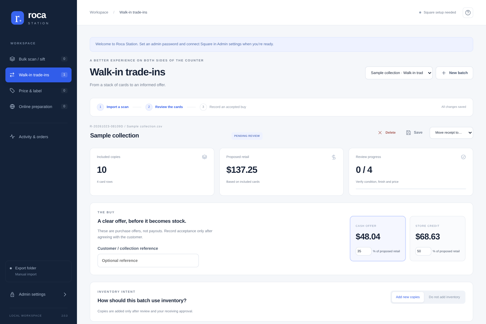

# Stock & Sleeve 2.6 local test preview

This preview adds a working local credit ledger and cleanup eligibility checks.
Shared credit, live automatic Square discount redemption, deployed OAuth and
catalog deletion are not enabled. See [release scope](docs/RELEASE_2_6_0.md).
The detailed 2.5 workflow documentation below remains useful for receiving.

Includes price-specific Square variations, a Price research tab, separate intake/retail recommendations, Pokémon $1 labels and a persistent approved-trade summary. Two packages are available: **Standard** (offer calculator, no credit tracker) and **Credit tracker** (the same app plus local customer balances/history). Neither issues credit or changes Square financial transactions. See [editions and update instructions](docs/EDITIONS.md).

**Pricing access remains partial:** the public feed offers TCGplayer market/low references. Verified TCGplayer individual sold records and PriceCharting are not connected. Complete automatic multi-source pricing is gated until those sources are available; no subscription has been purchased. See [pricing coverage](docs/PRICING_PREVIEW.md).

A local receiving workspace for Roca Sifter exports, Square inventory, trade-in offers, and Zebra 2″ × 1″ labels.

**[Operator manual — PDF](docs/Roca_Station_Operator_Manual.pdf)** · **[One-page desk reference — PDF](docs/Roca_Station_Desk_Reference.pdf)**

The operator manual starts with a one-page daily guide, then covers extra workflows, admin setup, printing, troubleshooting and a fillable store profile.



## Start on Windows

After setup, open **Stock & Sleeve** from the Desktop or Start menu. The icon
starts the background service and opens the workspace without a command window.
Existing installations can run **Install shortcuts.cmd** once to add these icons.
Keep the application folder in its current location; the shortcuts point to it.

1. Download **Code → Download ZIP** from GitHub and extract the complete ZIP into a permanent, writable folder. Keep every application file together; this is no longer a single-file app.
2. Install Python 3.10 or newer if needed. The installer uses prebuilt Windows dependencies; Python 3.15.2 ARM64/x64 packages were checked, with full Windows startup still requiring a store test.
3. Run **Install dependencies.cmd** once, including when upgrading. It creates a local `.venv`, updates pip, and installs prebuilt packages without compiling them. On Windows, token encryption uses built-in DPAPI and does not install `cryptography`.
4. Double-click **Start Roca.vbs** for startup with no command window. **Start Roca.cmd** also starts in the background (its command window may flash briefly). Chrome displays **2.5.0**. Edge is never launched as a fallback.
5. Open **Admin settings**, create your own password (at least 12 characters), and enter your Square token. There is no default password.
6. Choose Production for a real store or Sandbox for a sandbox token. Test the connection, select the receiving store, and save.
7. Choose **Set up automatic pickup**, unlock Admin, then choose **Use Downloads folder** (or enter the actual Roca export folder) and save. Press Export in Roca; new CSVs open for review automatically. Review every included card before stock or labels.

### Run in the background

Closing Chrome leaves Roca and automatic export pickup running while this computer is awake and signed in. Double-click **Start Roca.vbs** again to reopen the same station. Roca does not start automatically after a reboot or Windows sign-out.

To shut down, save your edits, wait for **All changes saved**, close the Roca browser window, then double-click **Stop Roca.vbs** (or **Stop Roca.cmd**) and confirm. The stop shortcut waits for active inventory work; it does not force-kill Python processes. Wait for the stopped message before backing up or updating. Startup errors appear in a dialog; details are in **station_data/station.log** (rotated automatically).

When upgrading from a console-based version, close its old Roca/Python command window once, then replace the application files with this complete release. Preserve **station_data**, **outputs**, and settings; rerun the installer. If a background station is running from another folder, use **Stop Roca** from that folder first.

### Automatic updates

If you received the versioned **Standard Auto Update ZIP**, extract all of it
into a separate folder and run **Install Roca Update.cmd**. Choose your existing
Roca folder, then **Update & reopen Roca**. The release is included, so no GitHub
connection is required; package installation may still need internet. Your saved
work is backed up and retained. Leave the included application.zip zipped. This
installs Standard, keeping the cash/store-credit offer calculator without enabling
the optional credit tracker.

For future updates, double-click **Update Roca.vbs** in the application folder. Save your work, close the Roca browser window, then select **Update & reopen Roca**. The updater downloads the current GitHub revision, waits for the station to stop, creates a backup, installs the packages and application files, and reopens Chrome. It does not require a Square token or admin password.

For an older installation that has no updater yet, **[download the small automatic updater](https://raw.githubusercontent.com/thundergamescda/RocaSifter/main/docs/Roca_Automatic_Updater.zip)**, extract its two files together, and double-click **Update Roca.cmd**. Choose your existing application folder and select **Update & reopen Roca**. If asked, close the older Roca command window once; the updater continues automatically. Newer versions stop through their authenticated local shutdown endpoint and finish active receiving first.

Your `station_data`, `outputs`, settings and root CSV/PDF/ZPL files are preserved. Backups are kept in `backups/<date-and-time>/files`, with a setup log and update record beside them. The Python environment is excluded from backups; the updater installs the required packages in that environment. If file installation or its import check fails, it restores the previous application files. A dependency failure leaves application files unchanged and reports its log. Keep the same Windows account so your saved Square credential remains readable.

The updater uses only the Python standard library (including Tcl/Tk for its window). No Git client, GitHub login or manual file copying is required. Updates run when you choose; they are not installed during normal work. The app refuses to start while its updater holds the installation lock.

Python command-line equivalent:

```sh
python -m pip install -r requirements.txt
python roca_to_square.py
```

The app serves only the local computer at `127.0.0.1`. A responsive layout supports smaller browser windows, but this release does not expose a network server for other devices.

## The everyday job in three steps

**Process cards** is the default home screen. Extra settings stay out of the way until needed.

1. **Export:** press Export in Roca and save its CSV in the configured folder. The app picks it up and opens it for review. **Choose a file instead** remains available for manual intake.
2. **Check cards:** review the physical cards, correct any details, mark the included cards checked, then choose **Continue**.
3. **Finish:** choose **Add to Square & create labels** or **Create labels only**. The Square action asks for final approval before adding copies. Open the labels to print, then choose **Next batch** to review the next queued export or wait for a new one.

**Batch history** reopens saved work and generated files. Reprints do not add copies. **Batch options** holds notes, Save now, deletion and moving the current stack into another workflow. Printer layout and DPI are saved in Admin; session overrides are under **More options** at Finish.

## Extra workflows when you need them

| Where | Job | Inventory behavior |
| --- | --- | --- |
| **Customer trade-in** | Review cards, agree on cash/store credit and record the buy, then choose stock and labels | Acceptance is recorded before receiving or retail labeling. Payment/credit issuance happens outside this app. |
| **More tools → Find value in bulk** | Apply a value threshold, select cards and continue the same batch in Process cards | Filtering and moving never add stock. |
| **More tools → Online preparation** | Prepare a listing review CSV and a storage ticket for an online bin or display case | Choose whether to add stock at Finish. A storage location is required before receiving. Nothing is published online. |
| **More tools → Orders & activity** | Record manual order-pull tasks and look up batch events | Staff confirm physical removal. Pull tasks do not change stock; marketplace synchronization is not connected. |

Navigation opens a fresh workspace, saving pending edits first. Waiting exports open automatically when no batch or dialog is open; an active batch is never replaced. **Batch options → Continue this batch in** moves the same physical stack to another workflow. A received batch remains safe to reopen and reprint.

## A separate inventory choice for each batch

Each new batch reaches Finish with no inventory choice selected. Choosing **Create labels only** adds no stock; choosing **Add to Square & create labels** requires a final quantity confirmation. The choice is saved on that batch and never becomes the next batch’s default. Folder pickup creates unchecked drafts. Bulk sift asks for inventory only after continuing into a receiving workflow. The receiving backend and saved request journal continue to protect retries and reprints.

## Delete and restore receipts

Open a batch and choose **Batch options → Delete batch**, then confirm. It disappears from the active list and the current workflow returns to the import screen. Deletion does not remove stock from Square, undo a buy, or delete generated documents. The saved record, source fingerprint and Square request journal are retained so deletion cannot bypass duplicate-receiving protection.

Reimporting the same CSV, or opening that receipt from **Activity & orders**, offers to restore it with its original inventory status. A received receipt remains received. Unresolved or in-progress receiving must be resolved before deletion. Existing databases are upgraded in place; preserve `station_data` when updating.

## Reviewing cards

- Open a card’s editor to correct name, set, collector number, language, condition, finish/treatment, quantity, price, or storage location.
- Finish is a free-text field with optional suggestions, not a fixed list. Future/custom treatments are supported.
- Changing identity or treatment clears review and requests fresh research for the corrected card. Unknown treatments and slabs need manual confirmation; a raw-card reference cannot value a slab.
- **Separate one copy** separates one card from a quantity so it can receive a different condition or treatment. The total incoming quantity is preserved by the UI.
- Confirm each card, or explicitly confirm that all included cards have been physically reviewed.
- Search and review filters operate across the entire receipt. The table renders 40 rows per page; an 11,000-row import was exercised in the browser.
- After accepting a buy, card identity/quantity and the agreed offer are locked; retail prices can still be reviewed before receiving. After receiving, prices are locked as well. Notes and storage assignments can still be updated. Handle post-receiving stock corrections in Square and record a separate correction workflow rather than rewriting a committed receipt.

Cash and store-credit percentages are configurable defaults, not recommended buying rates. Offers use included quantities and the approved intake values, falling back to the entered price. The Pokémon retail rounding rule does not inflate intake values. Accepted buys are saved separately from inventory receiving, and include an acceptance PDF. They do not transfer money, issue store credit, or create a legal customer signature.

## Manual labels and inventory

Use **Add item** beside New batch for a graded card or any custom item. On a blank workspace it creates a manual batch without a CSV. In an unfinished batch, including a trade-in, it adds the item alongside the scanned cards.

Enter the item name, **selling / label price**, quantity and condition/grade, such as **PSA 10**, **BGS 9.5** or any other text. Set, collector number, finish and language are optional details. Manual prices keep the cents you enter, except Pokémon retail values of $0.50–$1.00 follow the explicit $1 label rule; the original intake value is retained. Grade participates in item identity, so PSA 9 and PSA 10 do not share a generated SKU. If an individual slab needs a separate identity, include its certification/reference in the name. Side-fold QR labels show the condition/grade; include it in the name when using standard/top-fold labels, which print only the name and price.

The new item is unchecked. Verify it, Continue, then choose **Create labels only** or **Add to Square & create labels**, using the same final stock confirmation as scanned cards. In a trade-in, your entered price is the retail value: **the existing cash/store-credit percentages apply normally**. There is no separate fixed buying-price override.

Adding an item never changes Square by itself. Repeated submission of the same request does not add another copy, including after a lost response or restart. Accepted purchases and received/pending-retry batches cannot accept more items; start another batch instead. Adding to an editable batch clears its old output links so labels/listing files are regenerated for the new contents. Existing exported files stay on disk.

## In-app price research

The **Price research** tab sits beside **Check cards**. Imports and corrected identities queue background research; duplicate identities share a cached lookup. Results stay inside the app, with separate intake and retail recommendations and visible source availability. Slabs need exact grader/grade evidence; unmatched cards retain their entered values.

Current live adapter: daily TCGplayer market/low references for exact English Near Mint cards. Individual TCGplayer sold records and PriceCharting are **not connected**. Partial suggestions require approval and cannot silently correct prices. The public feed could not be validated live from this environment (proxy HTTP 403); fixture tests do not prove real pricing accuracy.

Once all three required sources have verified records, intake prefers the lowest matching listing (then the intake percentage); retail weights recent sold median at 75% and the exact guide at 25% (then the retail percentage). Those weights are a transparent initial policy, not a guarantee of appraisal accuracy. Automatic corrections require complete matching evidence, no source conflict and a small difference from the current price. **Over 15% and at least $1** flags review; both limits and automatic correction are adjustable in Admin. Explicit/manual retail prices, accepted intake amounts, generated retail documents and received stock are protected.

Pokémon retail values from **$0.50 through $1.00** become **$1 labels**, while the intake amount stays separate. Existing received shelf stock is never silently rounded or repriced. See [pricing coverage](docs/PRICING_PREVIEW.md).

## Password-protected Admin


Admin protects the Square credential, environment/location, watched folder, and workflow defaults. Operators can use the saved connection without entering or seeing the token. A blank token field keeps the saved credential. Saving a changed Square connection validates its active location before accepting it.

Passwords are stored as salted PBKDF2 hashes; sessions use HttpOnly/SameSite cookies, expire, and are revoked on password change. Closing the Admin dialog locks it. Login attempts are rate limited. The old unprotected settings/write routes are retired, and public settings never contain the token or password hash.

Credentials are encrypted locally: Windows uses the current Windows user’s DPAPI; other supported development hosts use a local Fernet key with restricted files. This protects the application boundary and local credential files; it is not an operating-system account isolation system. Keep the workstation account and `station_data` private. There is no browser password-reset bypass.

An old `roca_settings.json` token is migrated into the vault on startup and removed from that settings file only after the encrypted credential is readable. Existing backup copies of older settings are outside this migration.

## Automatic Roca export pickup

Set this up once in **Admin → Automatic export pickup**. Choose **Use Downloads folder** for the Windows account’s actual Downloads location (including folder redirection), or enter the folder your browser uses for Roca exports. Keep **Process cards** as the default workflow for routine receiving, then save. Make sure the browser saves Roca CSVs into that same folder. No Chrome extension is required.

Press **Export** in Roca. The watcher checks every two seconds and waits for unchanged size/mtime across checks, then checks again after reading. New drafts appear in the free workspace within a few seconds. If you are editing, printing or in a dialog, incoming exports wait in a persistent queue. **Review next export** switches when you choose; **Next batch** opens the next waiting export. Closing Chrome leaves pickup running; reopening the station continues the saved queue.

Existing CSVs are left alone when a folder is enabled or changed. The checkpoint is stored with station_data, so restarting does not reprocess old downloads. Files exported while the station is closed are found after restarting, provided pickup was already configured. Uppercase `.CSV` is supported; temporary downloads such as `.crdownload` are ignored. Locked files are retried, and a bad CSV does not block valid ones. Correcting and saving a bad file retries it. Only the selected folder is watched, without subfolders or symlinks.

Pickup creates **unchecked drafts** with no stock decision selected. It never accepts buys, prints labels or adds stock. Identical CSV content, including renamed/repeated downloads, does not create or queue another batch. Use the manual **new delivery** override only for genuinely additional physical cards with identical CSV content. Corrected or cumulative exports may overlap previously received stock; check them before approval. The watcher does not modify Roca files or control the mechanical bins.

To turn pickup off, clear the export folder in Admin and save. Queued batches remain saved. Each automatically collected batch uses the configured default workflow; use **Batch options → Continue this batch in** if it belongs to a trade-in or another job.

## Square receiving and duplicate cards

New card identifiers are independent of CSV row order and price. They include card name, collector number, condition, finish, language and set. Supply consistent set data to keep editions separate. Common condition/non-foil aliases are normalized; different variants stay separate.

Repeated matching CSV rows are grouped for the inventory request. A matching Square SKU receives an additive adjustment from `NONE` to `IN_STOCK`, not an absolute count: 4 existing + 2 incoming = 6, absent intervening sales. Matching card details and price reuse that variation/SKU and add quantity. A different price creates a sibling variation with its own barcode under the same Square item. Older variations keep their prices. Multiple Square variations sharing a SKU, conflicting currency or inconsistent identity stop preflight. Labels use the SKU confirmed by receiving. Saved in-flight operations from older versions retain their original retry behavior.

Each receipt has one receiving operation. Repeating **Receive** after success is a no-op. The local SQLite journal stores outgoing payloads and Square idempotency keys before sending; retries use the saved payload, including timestamps, and reuse confirmed responses. This covers tested restarts and lost-response cases. A preflight error before any catalog/inventory write leaves the receipt editable; ambiguous or partial writes lock it for a saved retry. Restore the original environment/location before retrying. Do not create a new receipt as a workaround. Very old pending requests, manual Square changes during a pending operation, or persistent Square errors require merchant-side reconciliation; do not assume stock is correct until Square confirms it.

Square catalog and inventory are separate API operations. The app reports partial failures. When the item variation is sold through Square POS at the receiving location, Square’s inventory behavior applies; a custom-amount sale cannot identify the card. Validate your real POS/location/variation-tracking configuration before rolling out shared stock.

**Version 1 stock:** older releases generated row-dependent SKUs. Add the existing **12-digit Square SKU** in a `Square SKU` or `SKU` CSV column to preserve that original item/label and add copies to it. Do not silently remap existing items by card name. No migration of live Square items was performed.

## Zebra labels

Side fold is the default: card name, set/number, condition, finish, and price on the left; QR code on the right. Fold vertically down the center of the 2-inch width, with the QR half flat on the sleeve’s back. Apply adhesive to a sleeve/toploader, not a collectible card. Long text is shortened to fit the physical label.

- Stock is **2 inches wide × 1 inch high**; print PDFs at **Actual size / 100%**, with no fit-to-page scaling.
- Choose the actual ZD411D resolution: 203 or 300 DPI.
- QR contains the same 12-digit SKU used in Square. It requires a QR-capable scanner and a tested Square lookup workflow; a 1D laser scanner cannot read it.
- Standard and top-fold layouts retain linear Code 128.
- PDFs and raw ZPL are written to `outputs/` with unique names and linked in the receipt. Reprinting does not receive inventory.
- ZPL is a download for a configured raw-print workflow; this release does not submit jobs directly to a USB/wireless printer. The printer stays connected by USB unless separately configured with supported networking.

PDF barcode/QR decoding was tested at both supported resolutions. Actual Zebra output, media calibration, scanner compatibility, and a real Square sale still need a store acceptance test.

## Online preparation boundaries

The CSV is a **generic listing review sheet**, with SKU, identity, variant, quantity, price, channel and storage location. It is not guaranteed to match TCGplayer/eBay’s native import schema. Listings must be published through a verified seller workflow. Marketplace APIs, automatic delisting and automatic order notifications are not implemented in this release. Physical bins are configured in Roca; this app records where the approved cards are stored.

## Upgrading, files and backups

Close the old station before updating. Copy your old `roca_settings.json` into the new folder before the first version-2 launch if you want its token migrated. For subsequent version-2 updates, preserve the entire **station_data/** directory and **outputs/** while the station is closed. Do not replace them with empty directories from a clean installation. A Windows credential must be opened by the same Windows user; otherwise save a replacement token through Admin.

`station_data/` holds receipts, operations, preferences, password hashes, and encrypted credentials. It is excluded from Git, along with old settings, Python caches and generated outputs. Back up the complete directory while the app is closed, keep backups private, and restore to the same workstation/user or re-enter the token. Deleting it loses receipt history and duplicate protection.

## Validation and development

```sh
python -m pip install -r requirements-dev.txt
python -m unittest discover -v
python -m playwright install chromium
python browser_smoke.py
python browser_store_workflow.py
```

The browser test uses an isolated temporary database, fictional batch data, and no live merchant credentials. It exercises the import/check/finish flow, explicit/cancelled stock confirmation, labels-only, reprints, delete/restore, trade approval, arbitrary finish text and separate copies, same-batch workflow transfer, online storage guards, downloads, Admin defaults/lock, pull tasks, real file pickup, partial downloads, queued drafts, restart/reopen and duplicate reexports, fresh batches, manual-only labels and inventory, graded identity, exact prices, lost-response retry, mixed trade offers, mobile layout, and 11,000-row intake/paging/search. Screenshots are written to a temporary folder. `ROCA_BROWSER_PATH` can select a local Chrome/Chromium executable.

The automated backend suite covers auth boundaries, token redaction/encryption/migration, receiving deduplication, background instance identity, reopening, graceful shutdown during receiving, saved retries across restart, duplicate cards, trade approval, folder pickup, listing sheets, and label decoding. Square interactions are mocked. Browser and API validation here do not establish native Windows launcher/DPAPI behavior, physical printing, or a live merchant integration on your store machine.

## Windows setup fix in 2.0.1

If an older installer failed building a `cryptography` wheel, download this complete release and rerun **Install dependencies.cmd**. That package is no longer required on Windows. The crypto import is deferred to the non-Windows vault path; Windows credential encryption remains DPAPI. The launcher uses the installer's `.venv` so setup and startup cannot silently select different Python installations. No credentials or receipt history are removed.

If pip still reports no compatible prebuilt package, send the Python version/platform line printed by setup and the last portion of its error (no tokens or passwords). 64-bit Python 3.12 or 3.13 is the recommended baseline. A virtual environment cannot switch its underlying Python version: if an existing `.venv` uses an incompatible interpreter, rename only that `.venv` folder before creating a new one with the intended Python installation; preserve `station_data`, `outputs`, and settings.
