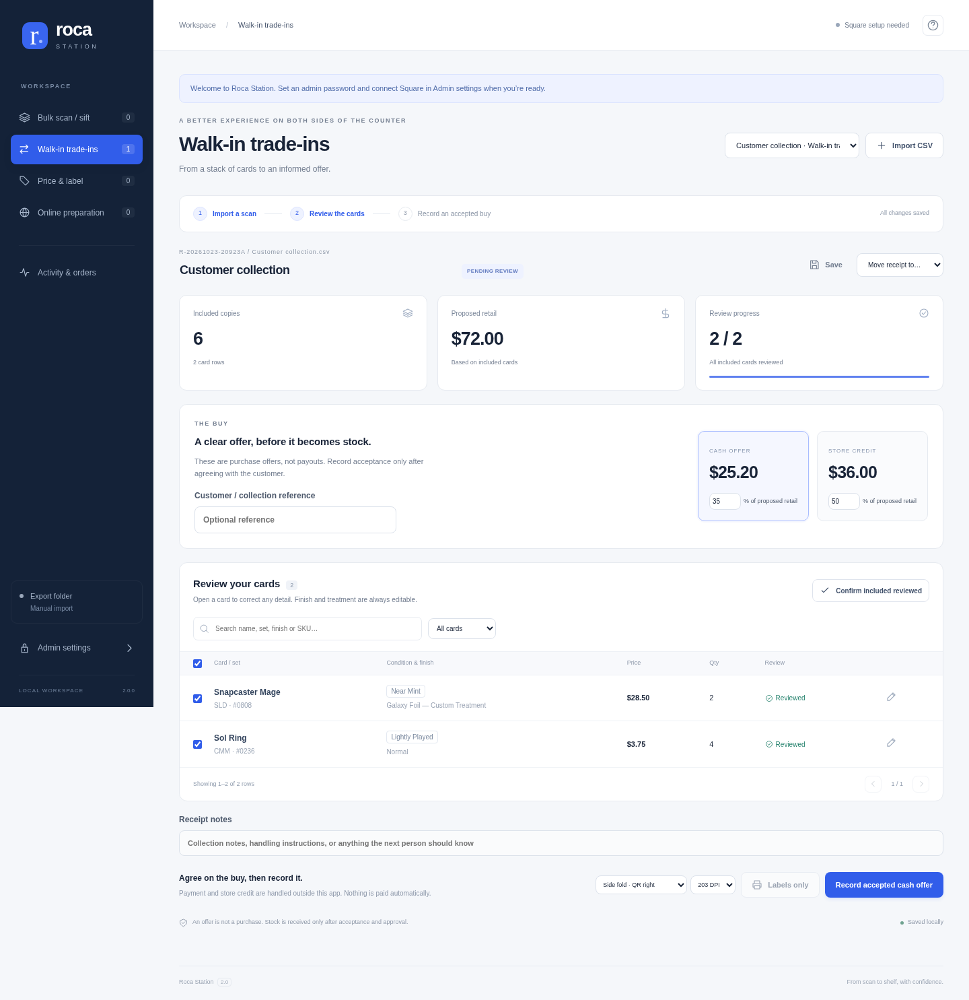
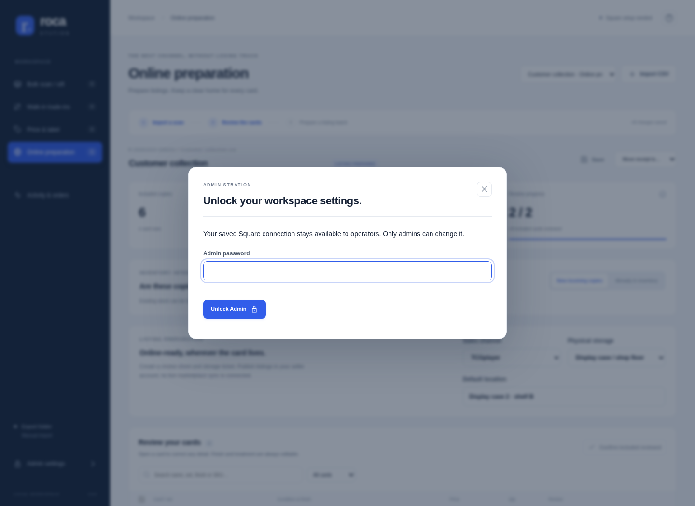

# Roca Station 2

A local receiving workspace for Roca Sifter exports, Square inventory, trade-in offers, and Zebra 2″ × 1″ labels.

**[Operator manual — PDF](docs/Roca_Station_Operator_Manual.pdf)** · **[One-page desk reference — PDF](docs/Roca_Station_Desk_Reference.pdf)**

The 23-page operator manual includes screenshots, all four workflows, admin setup, label printing, troubleshooting, and a fillable store profile.



## Start on Windows

1. Download **Code → Download ZIP** from GitHub and extract the complete ZIP into a permanent, writable folder. Keep every application file together; this is no longer a single-file app.
2. Install Python 3.10 or newer if needed.
3. Run **Install dependencies.cmd** once, including when upgrading. It creates a local `.venv`, updates pip, and installs prebuilt packages without compiling them. On Windows, token encryption uses built-in DPAPI and does not install `cryptography`.
4. Double-click **Start Roca.vbs** for startup with no command window. **Start Roca.cmd** also starts in the background (its command window may flash briefly). Chrome displays **2.0.4**. Edge is never launched as a fallback.
5. Open **Admin settings**, create your own password (at least 12 characters), and enter your Square token. There is no default password.
6. Choose Production for a real store or Sandbox for a sandbox token. Test the connection, select the receiving store, and save.
7. Import a Roca CSV or configure automatic export pickup in Admin. Review every included card before receiving stock or printing labels.

### Run in the background

Closing Chrome leaves Roca and automatic export pickup running while this computer is awake and signed in. Double-click **Start Roca.vbs** again to reopen the same station. Roca does not start automatically after a reboot or Windows sign-out.

To shut down, save your edits, wait for **All changes saved**, close the Roca browser window, then double-click **Stop Roca.vbs** (or **Stop Roca.cmd**) and confirm. The stop shortcut waits for active inventory work; it does not force-kill Python processes. Wait for the stopped message before backing up or updating. Startup errors appear in a dialog; details are in **station_data/station.log** (rotated automatically).

When upgrading from a console-based version, close its old Roca/Python command window once, then replace the application files with this complete release. Preserve **station_data**, **outputs**, and settings; rerun the installer. If a background station is running from another folder, use **Stop Roca** from that folder first.

### Automatic updates

For future updates, double-click **Update Roca.vbs** in the application folder. Save your work, close the Roca browser window, then select **Update & reopen Roca**. The updater downloads the current GitHub revision, waits for the station to stop, creates a backup, installs the packages and application files, and reopens Chrome. It does not require a Square token or admin password.

For an older installation that has no updater yet, **[download the small automatic updater](https://raw.githubusercontent.com/thundergamescda/RocaSifter/main/docs/Roca_Automatic_Updater.zip)**, extract its two files together, and double-click **Update Roca.cmd**. Choose your existing application folder and select **Update & reopen Roca**. If asked, close the older Roca command window once; the updater continues automatically. Newer versions stop through their authenticated local shutdown endpoint and finish active receiving first.

Your `station_data`, `outputs`, settings and root CSV/PDF/ZPL files are preserved. Backups are kept in `backups/<date-and-time>/files`, with a setup log and update record beside them. The Python environment is excluded from backups; the updater installs the required packages in that environment. If file installation or its import check fails, it restores the previous application files. A dependency failure leaves application files unchanged and reports its log. Keep the same Windows account so your saved Square credential remains readable.

The updater uses only the Python standard library (including Tcl/Tk for its window). No Git client, GitHub login or manual file copying is required. Updates run when you choose; they are not installed during normal work. The app refuses to start while its updater holds the installation lock.

Python command-line equivalent:

```sh
python -m pip install -r requirements.txt
python roca_to_square.py
```

The app serves only the local computer at `127.0.0.1`. A responsive layout supports smaller browser windows, but this release does not expose a network server for other devices.

## Four workflows, one receipt

| Workflow | What it does | Inventory behavior |
| --- | --- | --- |
| **Bulk scan / sift** | Imports all bins, applies a value threshold, and identifies what deserves further processing | Never receives stock. Move the same receipt to the next workflow. |
| **Walk-in trade-ins** | Reviews card details and calculates adjustable cash/store-credit offers; records the agreed buy and a printable acceptance record | Acceptance is recorded before receiving or retail labeling. Payment/credit issuance happens outside this app. |
| **Price & label** | Reviews final prices and produces side-fold QR, standard, or top-fold labels | Choose **Add new copies** to receive stock, or **Do not add inventory** for labels without adding copies. |
| **Online preparation** | Prepares a listing review CSV and a storage ticket for an online bin or a display case | **Receive & prepare** receives new stock first. **Prepare only** creates files without changing stock. Nothing is published online. |

Switching navigation tabs opens that workflow’s fresh import screen. **New batch** saves pending receipt edits and returns to a blank import screen with fresh review/search controls. Saved receipts remain available from **Open a saved receipt**; incoming folder notifications do not open them automatically. Use **Move receipt to…** to continue the same physical receipt in another workflow. Moving it does not receive it again. A received receipt is safe to reopen and reprint.

**Activity & orders** records receipt history and manual online-order pull tasks. A task includes an order reference, card details, quantity, and physical storage location. Staff explicitly confirm removal from the display or bin. Task confirmation does not change stock; live marketplace sale synchronization is not connected.

## A separate inventory choice for each batch

Each new trade-in, price/label or online batch asks whether to **Add new copies to Square** or **Do not add inventory**. The choice is saved on that receipt; it never becomes a default for the next batch. **Decide later** leaves receiving disabled until you choose in the inventory panel. A bulk sift never receives stock; moving an undecided bulk receipt into a receiving workflow asks for its choice. Folder pickup creates an undecided draft and asks when you open it. Labels only and preparation only remain available as explicit actions that do not add stock.

## Delete and restore receipts

Open a receipt and choose **Delete**, then confirm. It disappears from the active list and the current workflow returns to the import screen. Deletion does not remove stock from Square, undo a buy, or delete generated documents. The saved record, source fingerprint and Square request journal are retained so deletion cannot bypass duplicate-receiving protection.

Reimporting the same CSV, or opening that receipt from **Activity & orders**, offers to restore it with its original inventory status. A received receipt remains received. Unresolved or in-progress receiving must be resolved before deletion. Existing databases are upgraded in place; preserve `station_data` when updating.

## Reviewing cards

- Open a card’s editor to correct name, set, collector number, language, condition, finish/treatment, quantity, price, or storage location.
- Finish is a free-text field with optional suggestions, not a fixed list. Future/custom treatments are supported.
- Changing identity or treatment clears the review confirmation and a legacy SKU override in the editor. Confirm the price for the corrected variant; no live market-price lookup is connected.
- **Split one copy** separates one card from a quantity so it can receive a different condition or treatment. The total incoming quantity is preserved by the UI.
- Confirm each card, or explicitly confirm that all included cards have been physically reviewed.
- Search and review filters operate across the entire receipt. The table renders 40 rows per page; an 11,000-row import was exercised in the browser.
- After accepting a buy or receiving stock, card identity/quantity/price are locked. Notes and storage assignments can still be updated. Handle post-receiving stock corrections in Square and record a separate correction workflow rather than rewriting a committed receipt.

Cash and store-credit percentages are configurable defaults, not recommended buying rates. Offers use included quantities and proposed retail prices. Accepted buys are saved separately from inventory receiving, and include an acceptance PDF. They do not transfer money, issue store credit, or create a legal customer signature.

## Password-protected Admin



Admin protects the Square credential, environment/location, watched folder, and workflow defaults. Operators can use the saved connection without entering or seeing the token. A blank token field keeps the saved credential. Saving a changed Square connection validates its active location before accepting it.

Passwords are stored as salted PBKDF2 hashes; sessions use HttpOnly/SameSite cookies, expire, and are revoked on password change. Closing the Admin dialog locks it. Login attempts are rate limited. The old unprotected settings/write routes are retired, and public settings never contain the token or password hash.

Credentials are encrypted locally: Windows uses the current Windows user’s DPAPI; other supported development hosts use a local Fernet key with restricted files. This protects the application boundary and local credential files; it is not an operating-system account isolation system. Keep the workstation account and `station_data` private. There is no browser password-reset bypass.

An old `roca_settings.json` token is migrated into the vault on startup and removed from that settings file only after the encrypted credential is readable. Existing backup copies of older settings are outside this migration.

## Automatic Roca export pickup

In Admin, enter an existing export folder on the station computer and choose its default workflow. Leave it blank for manual imports.

The watcher checks CSVs for unchanged size/mtime before reading and checks again after reading. Imported files become **unreviewed drafts**; they never accept buys, print, or receive stock automatically. An invalid file is reported without preventing valid files from being picked up. Saving a corrected file allows it to be examined again.

Identical CSV content, including a renamed copy, opens its existing receipt. Manual intake offers a deliberate **new delivery** override for genuinely additional physical stock. Filename changes alone do not make a new delivery. Corrected or cumulative exports may have different content and cannot be reliably identified as the same physical receipt without stable Roca scan identifiers. Review them for overlap before approval; do not blindly receive re-exports. The watcher does not modify Roca files or control Roca’s mechanical bins.

## Square receiving and duplicate cards

New card identifiers are independent of CSV row order and price. They include card name, collector number, condition, finish, language and set. Supply consistent set data to keep editions separate. Common condition/non-foil aliases are normalized; different variants stay separate.

Repeated matching CSV rows are grouped for the inventory request. A matching Square SKU receives an additive adjustment from `NONE` to `IN_STOCK`, not an absolute count: 4 existing + 2 incoming = 6, absent intervening sales. Existing prices are preserved, and a mismatch between the CSV label price and Square price stops preflight. Multiple Square variations sharing a SKU also stop preflight.

Each receipt has one receiving operation. Repeating **Receive** after success is a no-op. The local SQLite journal stores outgoing payloads and Square idempotency keys before sending; retries use the saved payload, including timestamps, and reuse confirmed responses. This covers tested restarts and lost-response cases. A preflight error before any catalog/inventory write leaves the receipt editable; ambiguous or partial writes lock it for a saved retry. Restore the original environment/location before retrying. Do not create a new receipt as a workaround. Very old pending requests, manual Square changes during a pending operation, or persistent Square errors require merchant-side reconciliation; do not assume stock is correct until Square confirms it.

Square catalog and inventory are separate API operations. The app reports partial failures. When the item variation is sold through Square POS at the receiving location, Square’s inventory behavior applies; a custom-amount sale cannot identify the card. Validate your real POS/location/variation-tracking configuration before rolling out shared stock.

**Version 1 stock:** older releases generated row-dependent SKUs. Add the existing **12-digit Square SKU** in a `Square SKU` or `SKU` CSV column to preserve that original item/label and add copies to it. Do not silently remap existing items by card name. No migration of live Square items was performed.

## Zebra labels

Side fold is the default: card name, set/number, condition, finish, and price on the left; QR code on the right. Fold vertically down the center of the 2-inch width, with the QR half flat on the sleeve’s back. Apply adhesive to a sleeve/toploader, not a collectible card. Long text is shortened to fit the physical label.

- Stock is **2 inches wide × 1 inch high**; print PDFs at **Actual size / 100%**, with no fit-to-page scaling.
- Choose the actual ZD411D resolution: 203 or 300 DPI.
- QR contains the same 12-digit SKU used in Square. It requires a QR-capable scanner and a tested Square lookup workflow; a 1D laser scanner cannot read it.
- Standard and top-fold layouts retain linear Code 128.
- PDFs and raw ZPL are written to `outputs/` with unique names and linked in the receipt. Reprinting does not receive inventory.
- ZPL is a download for a configured raw-print workflow; this release does not submit jobs directly to a USB/wireless printer. The printer stays connected by USB unless separately configured with supported networking.

PDF barcode/QR decoding was tested at both supported resolutions. Actual Zebra output, media calibration, scanner compatibility, and a real Square sale still need a store acceptance test.

## Online preparation boundaries

The CSV is a **generic listing review sheet**, with SKU, identity, variant, quantity, price, channel and storage location. It is not guaranteed to match TCGplayer/eBay’s native import schema. Listings must be published through a verified seller workflow. Marketplace APIs, automatic delisting, live price feeds, and automatic order notifications are not implemented in this release. Physical bins are configured in Roca; this app records where the approved cards are stored.

## Upgrading, files and backups

Close the old station before updating. Copy your old `roca_settings.json` into the new folder before the first version-2 launch if you want its token migrated. For subsequent version-2 updates, preserve the entire **station_data/** directory and **outputs/** while the station is closed. Do not replace them with empty directories from a clean installation. A Windows credential must be opened by the same Windows user; otherwise save a replacement token through Admin.

`station_data/` holds receipts, operations, preferences, password hashes, and encrypted credentials. It is excluded from Git, along with old settings, Python caches and generated outputs. Back up the complete directory while the app is closed, keep backups private, and restore to the same workstation/user or re-enter the token. Deleting it loses receipt history and duplicate protection.

## Validation and development

```sh
python -m pip install -r requirements-dev.txt
python -m unittest discover -v
python -m playwright install chromium
python browser_smoke.py
```

The browser test uses an isolated temporary database, fictional receipt data, and no live merchant credentials. It exercises trade-in editing, arbitrary finish text, review/acceptance, labels, tab transfer, display-case preparation, downloads, admin setup/save/lock, pull tasks, mobile layout, and 11,000-row intake/paging/search. Screenshots are written to a temporary folder. `ROCA_BROWSER_PATH` can select a local Chrome/Chromium executable.

The automated backend suite covers auth boundaries, token redaction/encryption/migration, receiving deduplication, background instance identity, reopening, graceful shutdown during receiving, saved retries across restart, duplicate cards, trade approval, folder pickup, listing sheets, and label decoding. Square interactions are mocked. Browser and API validation here do not establish native Windows launcher/DPAPI behavior, physical printing, or a live merchant integration on your store machine.

## Windows setup fix in 2.0.1

If an older installer failed building a `cryptography` wheel, download this complete release and rerun **Install dependencies.cmd**. That package is no longer required on Windows. The crypto import is deferred to the non-Windows vault path; Windows credential encryption remains DPAPI. The launcher uses the installer's `.venv` so setup and startup cannot silently select different Python installations. No credentials or receipt history are removed.

If pip still reports no compatible prebuilt package, send the Python version/platform line printed by setup and the last portion of its error (no tokens or passwords). 64-bit Python 3.12 or 3.13 is the recommended baseline. A virtual environment cannot switch its underlying Python version: if an existing `.venv` uses an incompatible interpreter, rename only that `.venv` folder before creating a new one with the intended Python installation; preserve `station_data`, `outputs`, and settings.
